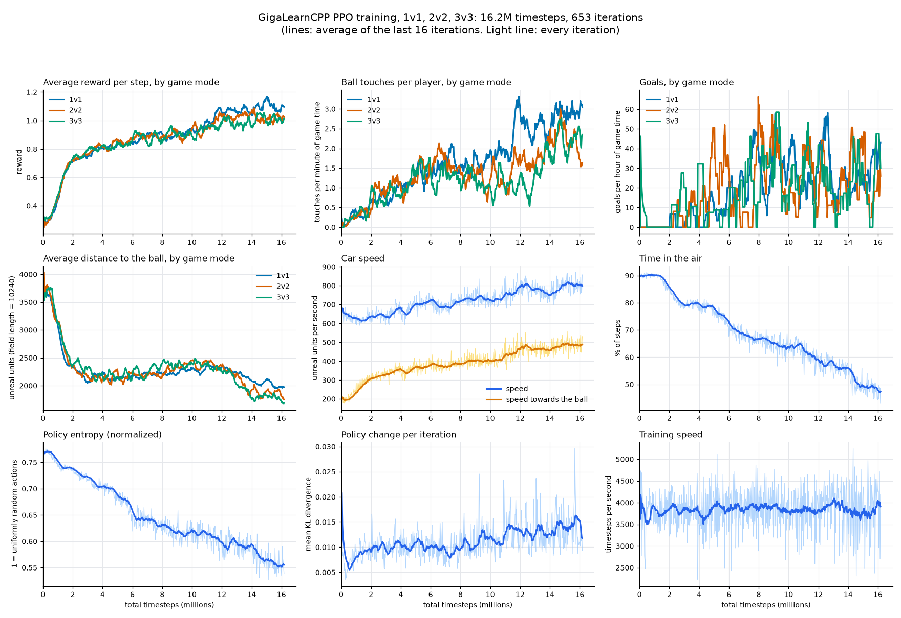

# One bot for 1v1, 2v2 and 3v3

The bot now has one set of inputs and one network that play 1v1, 2v2 and 3v3. This document describes the inputs,
the network, the size I chose as the final one, and the first training run of that model.

**Result of the first run:** in 70 minutes on this machine (16.2 million timesteps), the final model learned the
basics in all three modes. Against random actions it touches the ball 4.7 times per minute in 1v1, and as a team
7.8 times in 2v2 and 10.1 times in 3v3 (random actions: 0.2 to 0.6). It gets the first touch after 69%, 98% and 99%
of kickoffs, and it beats its own checkpoint from the middle of the run in every mode. It is a beginner: most
kickoffs still end without a goal. A strong bot needs far more training than this machine can do (see "The first
training run").

## The inputs

Every player gets 294 numbers per decision, in the same layout in every mode (`MultiModeObs`):

| Inputs | Count | Content |
|---|---|---|
| Boost pads | 34 | 1 if available, otherwise 1 / (1 + seconds until it is back) |
| Game mode | 3 | One-hot: 1v1, 2v2, 3v3 |
| Ball | 9 | Position, velocity, spin |
| Own car | 30 | See "A car" below |
| Own previous action | 8 | Throttle, steer, pitch, yaw, roll, jump, boost, handbrake |
| 2 teammate slots | 2 × 42 | A car, and how it relates to the own car (see "A slot" below) |
| 3 opponent slots | 3 × 42 | The same |

**A car (30):** position, forward direction, up direction, velocity and angular velocity (15). Angular velocity, ball
position and ball velocity in the car's own frame (9). Boost, on the ground, has a flip or jump left, is demolished,
has jumped, is supersonic (6).

**A slot (42):** "this slot is used" (1), "is a teammate" (1), the car (30), its position and velocity relative to the
own car (6), its position in the own car's frame (3), and its distance to the ball minus the own distance to the
ball (1). A slot without a player is all zeros.

On your two ideas:

- **Game mode as one-hot:** included.
- **"Slot is filled" input:** included, and the network depends on it. It is how the network knows which slots to
  leave out, so an empty slot has exactly no effect on the output. With it, the game mode input is redundant in
  principle (the mode follows from the used slots). I kept it because it costs 3 inputs and hands the mode to the
  main layers directly.

Other properties:

- Everything is seen from the player's own side of the field: for orange players the field is rotated by 180
  degrees. The same situation gives identical inputs to a blue and to an orange player (checked).
- The six "player slots" are the own car, two teammates and three opponents. Within the teammates and within the
  opponents the order is arbitrary, and the network does not depend on it.
- Every input is built from data that RLBot provides from the real game. Internal values of the simulation that
  the game does not show for other players (flip timers, handbrake state) are left out on purpose. Two things
  about the RLBot client, which I could not run:
  - It passed the boost pad timers on as the game gives them (seconds since pickup), while training uses the
    seconds until the pad is back. I changed it to convert them. This also affected the 1v1 example bot.
  - It does not track the 1.25 seconds in which a flip can still be used after a jump, so "has a flip or jump left"
    is approximate in the game.

## The network

```
   5 player slots (42 each)                 own car, ball, game mode (50)      boost pads (34)
        │                                         │        │                        │
        │  every used slot, together with ────────┘        │                        │
        ▼                                                  │                        │
   player encoder  92 → 256 → 256                          │                        │
   (the same weights for every slot)                       │                        │
        │                                                  │                        │
   teammates: maximum and mean  (2 × 256)                  │                        │
   opponents: maximum and mean  (2 × 256)                  │                        │
        │                                                  │                        │
        └────────────────────────┬─────────────────────────┴────────────────────────┘
                                 ▼
                 shared layers  1108 → 1024 → 1024 → 1024
                        ┌────────┴────────┐
                        ▼                 ▼
          policy  512 → 512 → 90     critic  512 → 512 → 1
          (which action to take)     (how good the situation is)
```

All layers are linear → layer norm → ReLU, as in the example. The shared layers are computed once and feed both the
policy and the critic.

Why the other players go through an encoder first, instead of all 294 inputs going into one plain network:

1. **The order of the players can't matter.** Maximum and mean don't depend on order. A plain network would have
   to learn the same thing separately for every order the slots can come in.
2. **Empty slots can't matter.** They are not computed at all.
3. **What is learned about one player applies to all.** The same encoder reads the one opponent in 1v1 and each of
   the three in 3v3, so every mode trains it for the others.
4. **It can compare.** The encoder sees each player together with the own car and the ball, so it can work out
   things like "this opponent reaches the ball before me" for each player on its own.

This follows the same idea as Nexto, the community bot that plays at about Grand Champion level in all three modes
with one network: it treats the players as a set of any size (with an attention mechanism instead of maximum and
mean). Sources: https://github.com/Rolv-Arild/Necto and its `bot.cfg`.

What I measured about this choice:

- Points 1 and 2 hold exactly: reordering the slots changes the output by 2e-07 (float rounding), and random values
  in empty slots change nothing.
- In short test runs with the small model, the encoder made no difference to how fast the first skill (driving to
  the ball) is learned per timestep: reward 0.87 with it and 0.86 with a plain network after 4 million steps. It
  costs time: 20,000 instead of 24,300 timesteps per second with the small model.
  That stage only needs the own car and the ball, so it can't show a benefit. Points 3 and 4 are about playing
  with and against others, which no run here got far enough to test. **The benefit is by design and by Nexto's
  example, not something I have measured.**
- One thing these runs did find: with the default initialization, the values from the encoder (512 in the small
  model, 1,024 in `l`) drowned out the 84 direct inputs in the first shared layer, and learning slowed down early.
  The weights for the encoder's values now start smaller, so that both groups have about equal weight. After
  4 million steps the small model was at reward 0.79 before and 0.87 after this change. `l` was at 0.77 before
  and 0.83 after, at 5 million steps (the first attempt at the training run, which I stopped and restarted).

## The size

| Model | Player encoder | Shared layers | Policy and critic | Parameters | Timesteps per second here |
|---|---|---|---|---|---|
| `s` | 128-128 | 256-256 | 256-256 | 0.54 million | 20,000 |
| `m` | 256-256 | 512-512-512 | 512-512 | 2.29 million | 7,000 |
| **`l`** | 256-256 | 1024-1024-1024 | 512-512 | **4.96 million** | 4,100 (3,840 over the whole training run) |
| `xl` | 512-512 | 2048-2048-1024 | 1024-1024 | 15.3 million | 1,300 |

"Here" is this sandbox: 2 CPU threads, no GPU. The same settings were used for each (those of the training run
below), one measurement each, taken together. The machine's speed varies by about 20% over time, so numbers measured
at different times don't compare exactly.

**I chose `l` as the final size:**

- The guides for this kind of bot say to make the network as big as the hardware allows, because bigger networks
  learn better, and that the size can't be changed later without starting over. Their numbers are for GPUs:
  4 layers of 1,024 "or larger" (https://github.com/Kuenec/GGL-Guide), and 2048-2048-1024-1024 on an RTX 3060 Ti
  (https://github.com/ZealanL/RLGym-PPO-Guide/blob/main/learner_settings.md). The same guide says to stay smaller
  without a GPU.
- `l` has shared layers of 1,024, the lower end of those recommendations, and its policy passes through
  7 hidden layers.
- It is the largest model that is practical in this sandbox: `xl` runs at 1,300 timesteps per second here,
  and its checkpoint (about 180 MB) does not fit the workspace.

Whether a strong bot needs this size is not known. Nexto's network is far smaller (layers of 128 to 512, as
described in https://arxiv.org/pdf/2305.15801). `m` trains 1.7 times as
fast on this machine, so if you stay on a CPU it may be the better trade. The size is the one decision here that
can't be changed later without retraining.

## The first training run

| | |
|---|---|
| Model | `l`, 4,957,275 parameters, trained from scratch |
| Games | 44 at once: 24 × 1v1, 12 × 2v2 and 8 × 3v3. That is 48 players, and so the same number of timesteps, in each mode |
| Opponents | Copies of itself (every car in every game is controlled by the network being trained) |
| Rewards, episodes, actions | As in the 1v1 run: the example's 10 rewards, half kickoffs and half random starts, 90 actions, 15 decisions per second. (Found later: the ball of the random starts hung in the air without moving, which wasted most of those episodes. This run was made that way, see `ELO_REPORT.md`) |
| PPO settings | 24,000 timesteps per iteration, one update per 1,500 timesteps, every timestep used once, learning rate 2e-4, entropy scale 0.018, gamma 0.99 |
| Length | 16,171,632 timesteps in 653 iterations, 70 minutes, 3,842 timesteps per second |



**The final checkpoint against random actions**, 240 minutes of game time per mode, kickoff starts:

| | 1v1 | 2v2 | 3v3 |
|---|---|---|---|
| Ball touches per minute, the bot's team | **4.7** | **7.8** | **10.1** |
| Ball touches per minute, random actions | 0.25 | 0.48 | 0.57 |
| First touch after kickoff, bot : random | 814 : 7 | 1,006 : 2 | 860 : 1 |
| Kickoffs | 1,179 | 1,029 | 866 |
| ... that ended without a goal (10 seconds with no touch) | 1,016 | 775 | 668 |
| Goals, bot : random | 96 : 3 | 188 : 3 | 132 : 3 |
| Time in the air (random actions: 89%) | 47% | 42% | 44% |

A second evaluation with other kickoffs gave 4.8, 8.1 and 9.9 touches per minute and 113 : 5, 148 : 5 and 142 : 7 goals.

**Progress during the run**, each checkpoint against random actions for 120 minutes per mode:

| Checkpoint | Touches per minute 1v1 / 2v2 / 3v3 | First touch after kickoff 1v1 / 2v2 / 3v3 |
|---|---|---|
| 2.0M steps | 1.1 / 2.3 / 3.5 | 14% / 29% / 39% |
| 4.0M steps | 1.8 / 3.9 / 5.2 | 24% / 48% / 57% |
| 8.0M steps | 3.3 / 5.8 / 6.8 | 47% / 70% / 81% |
| 12.0M steps | 5.0 / 6.9 / 8.0 | 71% / 92% / 95% |
| 16.2M steps (240 minutes) | 4.7 / 7.8 / 10.1 | 69% / 98% / 99% |

**The final checkpoint against its own earlier checkpoints**, 120 minutes per mode:

| Opponent | Goals 1v1 | Goals 2v2 | Goals 3v3 | First touch after kickoff 1v1 / 2v2 / 3v3 |
|---|---|---|---|---|
| Its 8.0M checkpoint | 80 : 11 | 69 : 8 | 57 : 8 | 91% / 94% / 93% |
| Its 2.0M checkpoint | 89 : 5 | 97 : 4 | 63 : 0 | 82% / 94% / 99% |

What this shows and what it doesn't:

- **All three modes are learned together.** The curves of the three modes run side by side, and every measure
  above improves in every mode.
- **It is a beginner.** In 1v1, 1,016 of 1,179 kickoffs ended with nobody touching the ball for 10 seconds. That is
  about one touch per kickoff: it gets to the ball, hits it, and mostly does not follow up.
- **It drives.** Time in the air fell from 90% to under 50%. The 1v1 example bot was still at 84% after its run.
- **Goals against random actions are a poor measure.** The 8.0M checkpoint scored more of them per minute (111, 147
  and 134 in 120 minutes) than the final one, which then beat it clearly in every mode. I don't know why it scored
  more against random actions.
- **Nothing here measures team play.** Touches and first touches would look the same if all cars simply went for
  the ball.
- **In the first 5 million steps, `l` learned more slowly per timestep than the small model** in its test run
  (reward 0.83 against 0.91). Whether that is the size, the settings (which were chosen with the small model) or
  chance, I can't say from one run each.
- It was only tested against random actions and its own checkpoints, and this is one run with one seed.

For scale: Nexto is reported to have had over 250,000 hours of training
(https://esteemstream.news/89719/personal-tech/gaming/the-rocket-league-ai-that-teaches-itself/). This run is about
300 hours of game time, counting every car. At 3,800 timesteps per second this machine adds about 250 hours of game
time per hour.

### Settings from short test runs

Before the run I compared settings with the small model, 3.5 minutes per run, one run each. The machine's speed
varied between runs, so the comparison is per timestep:

| Run | Updates per 24,000 timesteps | Reward per step at 1.5–2.0M steps | at 2.5–3.0M steps |
|---|---|---|---|
| Batches of 6,000, every timestep used once | 4 | 0.52 | 0.65 |
| Batches of 3,000, once | 8 | 0.61 | 0.72 |
| Batches of 6,000, twice | 8 | 0.70 | (run ended) |
| **Batches of 1,500, once** | 16 | 0.67 | 0.79 |
| Batches of 3,000, twice | 16 | 0.72 | (run ended) |
| Batches of 3,000, once, entropy scale 0.018 instead of 0.035 | 8 | 0.62 | 0.73 |

More updates per timestep learned faster. Using every timestep twice costs about half as much time again per
timestep, and small batches don't, so I used batches of 1,500. The lower entropy scale gave the same reward and
more ball touches (0.11% against 0.08% of steps at 2.5–3.0M), in line with the earlier test on the 1v1 bot, so I
used 0.018, the framework's default.

## Checks

`build/GigaLearnMultiModeTests` (build it with `cmake --build build --target GigaLearnMultiModeTests`):

- **Inputs**, on 200 random situations per mode: 294 finite values in every mode, the game mode input, the right
  number of used slots, empty slots all zero, the values that relate a slot to the own car, and identical inputs
  for both teams.
- **Network**: the output and the gradients match a second, direct implementation in 64-bit floats (differences of
  5e-07 and 2e-07). Slot order and empty-slot content have no effect. Saving, loading and copying keep the output.
- **Learning**: several threads and minibatches give the same gradients as the whole batch at once (4e-07), and
  actions inferred on several threads are the same as on one.

The earlier test of the learner's math (`GigaLearnTests`) still passes, and the 1v1 example bot and its
checkpoint work as before (`--model example`, or automatically for checkpoints without a note about their model).

The checkpoints from during the run (2.0M to 14.0M steps) are not kept, at 57 MB each they don't fit the workspace.
Their evaluation results are in `results/multi/eval/`.

## Speed on the CPU

Three changes were needed to make these models train at a usable speed here:

- **Picking the used slots and pooling them are single passes over the data** (`SlotPool.cpp`). Written with torch
  operations they took about 25 operations each way.
- **Actions are inferred on both CPU threads for big policies.** For the example bot the game simulation takes
  longer than choosing the actions, so one thread was enough. For `l` it was the other way around: choosing actions
  went from 131 to 87 ms per 1,000 timesteps.
- **Every learner thread gets the same number of minibatches.** With 3 minibatches on 2 threads, one thread waited.

With the first two, `l` went from 2,665 to 3,027 timesteps per second (measured when its policy and critic layers
were still 1024-512). What still limits it: choosing actions for 144 players at a time uses the big layers at about
half the speed that large batches reach (68–84 instead of 132 GFLOP/s per thread, measured), because every call
has to read all 17 MB of weights for few rows.

## Not tested

- **A GPU.** The slot encoder uses plain torch operations there. I could not run it.
- **The real game.** The RLBot client compiles with the new inputs (I added "is supersonic" to what it reads), but
  I have neither the game nor RLBot here.
- **Windows.**
- **Whether the settings found in short test runs hold for long ones.** Each was one run of 3.5 minutes with the
  small model.
- **Team play, other bots, humans.**

## Commands

```bash
./setup_linux.sh                                   # once per session: dependencies and build (3 minutes)
./train_multi.sh --max-minutes 60                  # train the final model (its checkpoint was removed later, see below: this starts it again)
python3 tools/show_progress.py metrics_multi       # progress table, with ball touches per mode
python3 tools/plot_metrics.py metrics_multi curves.png
./build/GigaLearnBot --eval checkpoints_multi --eval-arenas 64              # all three modes against random actions
./build/GigaLearnBot --eval checkpoints_multi --eval-modes 3v3 --vs <other checkpoint>
./build/GigaLearnBot --help                        # all options and models
```

A checkpoint remembers which model it was made with, so `--eval`, `--rlbot` and continued training pick the right
one. A new run with another size: `./train_multi.sh --model m --checkpoints <new folder>`.

## Files

| File | Content |
|---|---|
| `GigaLearnCPP/RLGymCPP/src/RLGymCPP/ObsBuilders/MultiModeObs.h/.cpp` | The inputs |
| `GigaLearnCPP/src/public/GigaLearnCPP/Util/ModelConfig.h` | `SlotEncoderConfig`: how a model is told about slots |
| `GigaLearnCPP/src/private/GigaLearnCPP/Util/Models.h/.cpp` | The slot encoder as part of a model |
| `GigaLearnCPP/src/private/GigaLearnCPP/Util/SlotPool.h/.cpp` | Fast CPU versions of its two steps |
| `GigaLearnCPP/tests/TestMultiMode.cpp` | The checks above |
| `src/ExampleMain.cpp` | `--model`, `--modes`, `--eval-modes`, metrics per mode |
| `train_multi.sh` | The training command for the final model |
| `checkpoints_multi/16171632/` | The trained model (57 MB). **Removed later:** the workspace is limited to 128 MB, and the small model `s` has been trained much further since (1v1 and 2v2, see `ELO_REPORT.md`). `./train_multi.sh` trains `l` again from the start, 70 minutes for the 16 million timesteps of this report |
| `metrics_multi/` | Its training metrics, which further training appends to |
| `results/multi/` | `training_curves.png`, `training_metrics.jsonl`, `train_log.txt`, `eval/` (all evaluations above), `pilots/` (metrics of the short test runs and of the first attempt), `benchmarks.jsonl` |
