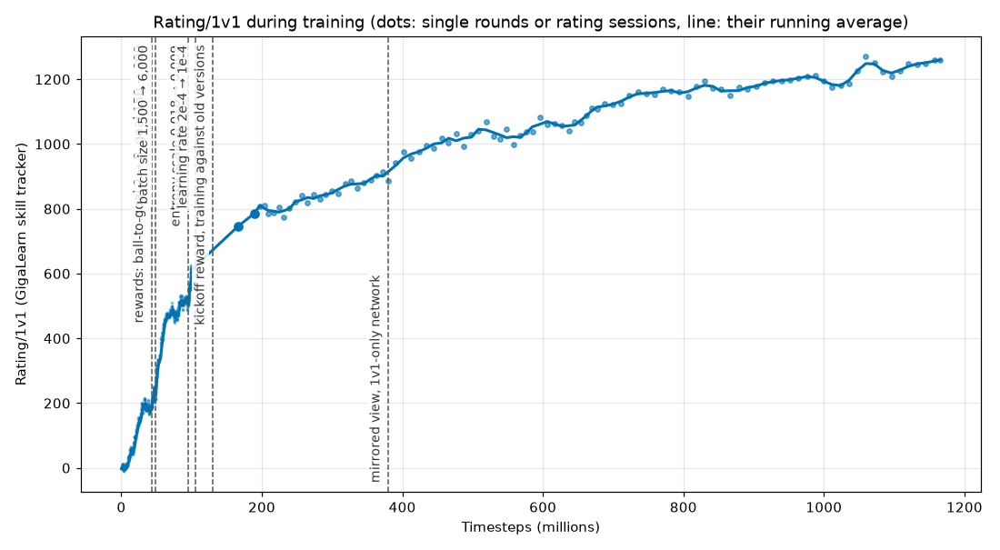
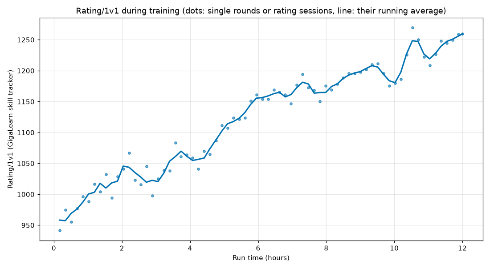

# 1v1 and 2v2 training, rated with GigaLearn's Elo rating

The bot (model `s`) trains with GigaLearn's own rating switched on: its policy versions (the checkpoint system for
opponents) and its skill tracker (the ranking system). The rating is the metric `Rating/1v1`, and since 2v2 was added
also `Rating/2v2`. Every run of this work reports them to Weights & Biases.

**In short:**

<!-- SUMMARY -->
- **The 1v1 + 2v2 run is in progress.** Its state is in `results/elo/run_1v1_2v2/progress.md`, which is rewritten
  every 10 minutes, and its newest checkpoint is always in `checkpoints/`.
<!-- /SUMMARY -->
- **The 12-hour 1v1 run took `Rating/1v1` from 885 to 1264.** The bot at its end beat the bot from its start 657:179
  in direct games. It trained 786 million timesteps (1.17 billion in total) at 18,200 per second, up from 13,600.
- **Two changes to the model made that run faster and the bot better at once.** With the *mirrored view* the network
  only ever sees its own car on one half of the field. That alone raised the rating by about 55 points before any
  training, because the bot had become better on the left half than on the right. The *1v1-only form* of the
  network leaves out what 1v1 never uses and is 10% faster with exactly the same output.
- **2v2 is now trained together with 1v1, by one network.** The 1v1 bot was converted back to the full network
  without changing its 1v1 play, and starts 2v2 with what it does in 1v1. Two rewards were changed so that a team
  is not paid twice for the same thing. Training runs at about 20,000 timesteps per second.
- **Every change to the training setup was decided by the rating.** Variants train for 5 minutes from the same
  checkpoint and are then rated against the same opponents. That found four gains (rewards for where the ball goes,
  bigger policy updates, less entropy, a lower learning rate) and five changes that did not help.
- **The rating caught two faults that no training metric showed.** A ball that hung in the air in half of the
  episodes, in my setup since the first training run. And a bot that stopped going for the ball at kickoffs, because
  its copy on the other side did the same. Both are fixed.
- **The rating games cost 2 to 3% of the run time.** They are played as one short session every 10 minutes, with
  nothing but training in between.
- **The workspace stays far below its 128 MB limit.** It holds four checkpoints and ten small policy versions,
  68 MB in total with everything else, and at most 77 MB while a checkpoint is being written. See
  [The workspace](#the-workspace).

I also fixed three problems in the skill tracker itself.

Contents: [Weights & Biases](#weights--biases) · [How the rating works](#how-the-rating-works) ·
[The ball that hung in the air](#the-ball-that-hung-in-the-air) · [Comparing training setups](#comparing-training-setups) ·
[The first training run](#the-first-training-run) · [When the rating stopped rising](#when-the-rating-stopped-rising) ·
[The kickoff](#the-kickoff-the-bot-got-worse-while-its-training-metrics-got-better) ·
[The run with rating sessions](#the-run-with-rating-sessions) ·
[The 12-hour run](#the-12-hour-run-a-mirrored-view-and-a-1v1-only-network) · [Adding 2v2](#adding-2v2) ·
[The workspace](#the-workspace) · [Continuing](#continuing) · [Files](#files)

## Weights & Biases

What I needed from your account:

| Item | What I used |
|---|---|
| API key | The key you gave me. It is passed to the training process as the environment variable `WANDB_API_KEY` and is stored outside the workspace. It is in no file of the repository, the patch or the logs. You can delete it at wandb.ai → User settings → API keys |
| Entity (user or team) | The default one of the key: `noluck942-idk` |
| Project | `rocket-league-ggl` (created by the first run) |

Nothing else was needed. Everything is at <https://wandb.ai/noluck942-idk/rocket-league-ggl>:

| Group | Runs |
|---|---|
| `training-1v1` | `s-1v1`: the training up to 130 million timesteps, with rating games every 12 seconds until 95.1 million. What it shows after 130 million is the abandoned part, see [The kickoff](#the-kickoff-the-bot-got-worse-while-its-training-metrics-got-better). `s-1v1-part2`: from 135 to 379.5 million, with rating sessions. `s-1v1-12h`: the 12-hour run, from 379.5 to 1,165.5 million |
| `training-1v1-2v2` | `s-1v1-2v2`: the same bot from 1,165.5 million on, trained in 1v1 and 2v2. It has `Rating/1v1` and `Rating/2v2` |
| `experiments-s-1v1` | The first experiments: `s-base` (their starting point, trained without rating), and the variants `s-control`, `s-moving-ball`, `s-kickoff-only`, `s-scoring-rewards`, `s-gamma-0.995` |
| `experiments-plateau-43M` | From 42.9 million timesteps: `p-batch-6k`, `p-goal-rewards` |
| `experiments-plateau-95M` | From 95.1 million: `c-control`, `c-train-vs-old`, `c-entropy-0.009` |
| `experiments-race2`, `experiments-race3` | From 100.1 and 105.1 million: `d-...` and `e-...` |
| `experiments-race4` | From 130.0 million, the kickoff fixes: `f-kickoff-reward`, `f-train-vs-old` |

The bot's training is spread over several of these runs, because each test that won became the next part of
it: `s-1v1` to 42.9 million timesteps, `p-goal-rewards` to 48.9, `s-1v1` to 95.1, `c-entropy-0.009` to 100.1,
`d-control` to 105.1, `e-lr-1e-4` to 110.1, `s-1v1` to 130.0, `f-kickoff-reward` to 135.0, `s-1v1-part2` to 379.5,
`s-1v1-12h` to 1,165.5, then `s-1v1-2v2`.

The charts use "Total Timesteps" as the x-axis. The ones that belong to the rating:

| Chart | Content |
|---|---|
| `Rating/1v1`, `Rating/2v2` | The Elo rating of the policy being trained, per game mode |
| `Skill Matches/Goals For`, `Goals Against` | Goals in the latest round of rating games, or in the whole session. With two modes also per mode: `Goals For 1v1`, `Goals Against 2v2`, ... |
| `Skill Matches/Kickoff First Touch Share` | Rating sessions: the share of kickoffs in which the bot touched the ball before its opponent |
| `Skill Matches/Opponent Timesteps`, `Opponent Rating 1v1` | Single rounds: which saved version was the opponent, and its rating |
| `Skill Matches/Versions`, `Game Minutes`, `Time`, `Rounds` | Number of saved versions, game time played, how long it took, and the number of rounds in a session |

The run config in wandb holds the settings of each run (model, rewards, PPO settings, tracker settings). The
experiment runs also have `Common Pool/Rating 1v1` in their summary: the rating from the comparisons below.

A training that is started again continues its wandb run (the run id is stored in the checkpoint). If it is started
with other settings, the run config shows the latest ones. The notes of the training runs say what changed when.

## How the rating works

Both parts are GigaLearn's own. I switched them on and made them options of `GigaLearnBot`.

**Policy versions.** Every `--ts-per-version` timesteps the learner saves a copy of the current policy into
`<checkpoints>/policy_versions/<timesteps>/`. It keeps the newest `--max-versions` and drops the oldest.

**Skill tracker.** Every `--skill-interval` iterations the current policy plays `--skill-arenas` games at once against
one of the saved versions, for `--skill-sim-time` seconds of game time. The opponent is picked at random and stays
until as many goals have been scored as there are games, or until `--skill-max-sim-time` seconds have been played.
Every goal moves two ratings by the Elo formula, with `--skill-rating-inc` points at stake:

    expected = 1 / (1 + 10 ^ ((loser - winner) / 400))
    winner += inc * (1 - expected)        loser -= inc * (1 - expected)

- The untrained network starts at 0, and so does the first saved version.
- A new version gets the rating that the policy has when it is saved.
- The rating is stored in every checkpoint (`RUNNING_STATS.json`) and for every version (`STATS.json`).

**Reading the number.** It is an Elo scale: 100 points more means about 64% of the goals, 200 points about 76%, 400
points about 91%. It is measured against the run's own earlier versions, so it shows how far a run has come. Ratings
of two different runs are only on the same scale if they share their versions (see
[Comparing training setups](#comparing-training-setups)).

A single reading is noisy, because each goal moves it by up to 5 points: it scatters by roughly ±15 points around its
level. It also lags, since it only moves when goals are scored: it takes in the order of 100 to 200 goals to follow
two thirds of a change. While the bot improves quickly, the reading is therefore below its real level.

**The settings.**

These are the settings up to 95.1 million timesteps. After that the rating games are played in sessions, see
[Rating sessions](#rating-sessions-how-often-to-rate-and-how-much).

| Option | Framework default | Training run | Experiments |
|---|---|---|---|
| `--skill-interval` | 16 iterations | 8 | 4 |
| `--skill-arenas`, `--skill-sim-time`, `--skill-max-sim-time` | 16 games, 45 s, 240 s | default | default |
| `--skill-rating-inc`, `--skill-initial-rating` | 5 points, 0 | default | default |
| `--skill-deterministic` | off (actions are sampled as in training) | default | default |
| `--ts-per-version` | 25 million | 2 million | 500,000 |
| `--max-versions` | 32 | 16 | 32 |

The default of 25 million timesteps per version is meant for GPU runs of billions of steps. Here the whole run is
95 million, so versions are saved more often. An iteration is also small on this machine (24,000
timesteps), so the rating games run every 8 iterations. They took 7% of the training time.

### What I changed in the tracker

| Change | Why |
|---|---|
| Every new opponent starts from kickoffs | The games were never reset between opponents: they went on from wherever the last opponent had left them, and the very first ones from the start states of training. Games that could not end (see the next section) stayed in the set for the rest of the run. In a test this cut the goals per game minute from 0.60 to 0.34. The config comment of `maxSimTime` already describes a reset |
| The ratings of the versions are saved with every checkpoint | They were written once, when a version was first saved. A resumed run got its old versions back at their first rating, while the current policy kept what it had won against them since |
| A first version is saved when there is none | So the tracker can be switched on for an existing checkpoint: the policy it starts with becomes the first opponent |
| More metrics | Goals, opponent and game time of each round (the `Skill Matches/...` charts), to see what a rating is based on |

| Rating sessions (later, on your request) | See the next section |
| Kickoff metric (later) | Which side touches the ball first after a kickoff, see [The kickoff](#the-kickoff-the-bot-got-worse-while-its-training-metrics-got-better) |

All of it is in `PolicyVersionManager.cpp`. The rating formula, the choice of opponents and the match rules are
unchanged: the games start from kickoffs and are played until a goal.

### Rating sessions: how often to rate, and how much

You asked for training that is as efficient by the clock as possible. First with rating games about every 30
minutes instead of all the time, then you left the amount to me. `train_1v1.sh` now uses a new mode of the tracker:

    --skill-minutes 10 --skill-rounds 10 --skill-arenas 32 --ts-per-version 25m

- **Every 10 minutes of run time the bot plays one rating session:** 10 rounds of 32 games, 11 to 15 seconds. In
  between there is nothing but training.
- **`Rating/1v1` gets one point per session.** It is the average of the rating after each of the last three quarters
  of the rounds. The first quarter lets the rating catch up with what the bot has learned since the last session.
  The bot's rating is then set to this average.
- **New policy versions are saved right after a session,** with the rating that the session found: at the first
  session after 25 million timesteps since the last version, which is every third session on this machine. A version
  saved between two sessions would carry the rating of the last session, which is out of date by then.
- **A run that ends by `--max-minutes` or `--max-timesteps` plays a final session** before it saves. Ctrl+C saves
  and exits at once.
- **Every session also reports who touches the ball first after a kickoff,** see
  [The kickoff](#the-kickoff-the-bot-got-worse-while-its-training-metrics-got-better).

The rating formula, the choice of opponents and the match rules are GigaLearn's as before.

**How I chose the numbers.**

*How long a session has to be.* 42 rating sessions of this work rated a checkpoint that did not change, over 40 to
90 rounds each. I cut them into pieces of n rounds and measured how far the result of one piece lies from the
others:

| Rounds in a session | 4 | 10 | 20 | 60 | 90 |
|---|---|---|---|---|---|
| Time when the machine does nothing else | 5 s | 12 s | 25 s | 75 s | 110 s |
| The result scatters by | ±18 | ±17 | ±16 | about ±13 | ±11 |

The scatter hardly depends on the length. The reason is the rating itself: every goal moves it by up to 5 points, so
it wanders by about ±19 around the bot's level however many games are played, and it needs about 7 rounds to follow
a change of the bot. A long session only averages this wandering out slowly. 60 rounds cost 6 times as much as 10
and are 1.3 times as exact.

The rating carries over from one session to the next, so short sessions are looks at the same running estimate, and
six short looks tell more than one long one. A session should not be much shorter than the 7 rounds that the rating
needs to follow the bot. That gives 10 rounds.

*How often.* More sessions cost run time. Fewer mean that a slide like the one at the kickoffs is seen later, and
all training after the slide began is lost. That slide needed about 10 minutes of training to become clear in the
rating. An estimate of the minutes lost per hour of training, with one slide every 3.3 to 10 hours (there was one in
the first 3.3 hours of this bot's training, and none in the 16 hours since). The rating games are measured: a
10-round session took 14.9 seconds on average in the run up to 379.5 million timesteps and 10.7 seconds in the 12-hour
run, and the two 60-round sessions took 81 and 104 seconds:

| Sessions | Rating games, minutes per hour | Lost to slides, minutes per hour | Together |
|---|---|---|---|
| 10 rounds every 5 minutes | 2.6 | 1.5 to 4.5 | 4.1 to 7.1 |
| **10 rounds every 10 minutes** | 1.3 | 2.0 to 6.0 | 3.3 to 7.3 |
| 10 rounds every 30 minutes | 0.4 | 4.0 to 12.0 | 4.4 to 12.4 |
| 60 rounds every 30 minutes (before) | 3.1 | 4.0 to 12.0 | 7.1 to 15.1 |

Every 5 or every 10 minutes come out about equal. I took 10 minutes, the cheaper of the two. Over the 12-hour run
the 71 sessions took 757 seconds together, 1.8% of the run time.

**The three settings of this work:**

| | First run | 30-minute sessions | Now |
|---|---|---|---|
| Rating games | 1 round of 16 games every 8 iterations (about every 12 seconds) | 60 rounds of 32 games every 30 minutes | 10 rounds of 32 games every 10 minutes |
| Share of the run time | 6.5% | 5.1% | 1.8 to 2.5% |
| Points of `Rating/1v1` per hour | About 290 | 2 | 6 |
| One point scatters by | About ±15 | About ±13 | About ±17 |
| A slide is seen after | A few minutes | Up to 30 minutes | Up to 10 minutes |
| New policy versions | Every 2 million timesteps | After every session | After a session, every 25 million timesteps |

**What the short sessions do not give** is an exact number per point. The curve in wandb zigzags by about ±17
points, and a trend shows over three or more points (wandb's smoothing helps). For an exact rating of one
checkpoint, use the command of the next section: 90 rounds rate it to ±11 points in about 2 minutes.

### Rating a checkpoint without training

`--rate-rounds N` loads the newest checkpoint of `--checkpoints` and only plays the tracker's games, N rounds of them.
Nothing is saved. With `--rate-versions <folder>` the opponents are the saved versions of another run.

    build/GigaLearnBot --modes 1v1 --device cpu --checkpoints runs/A/ckpt --rate-rounds 90 --skill-arenas 32 \
        --rate-versions runs/control/ckpt/policy_versions --rate-out ratings/A.json
    tools/show_rating.py ratings/*.json

It reports the average of `Rating/1v1` over the last three quarters of the rounds. 90 rounds with 32 games are about
1,350 goals and take 100 seconds on this machine. Such a session is good to about ±15 points: three checkpoints that
I rated twice came out 9, 11 and 35 points apart.

## The ball that hung in the air

Half of the training episodes start from a random state instead of a kickoff (`--random-state-prob 0.5`, my setting
since the first training run). In these episodes the ball was placed at a random height of up to 1,800 units without
any speed. RocketSim puts a ball without any speed and spin to sleep until something touches it (`Arena::Step`,
"Ball zero-vel sleeping"), which is how the kickoff ball stays in place. So the ball hung in the air for the whole
episode, out of reach for a bot on the ground in about 9 of 10 cases, until the episode ended after 10 seconds without
a touch.

I found it through the rating games. They took their very first positions from training and have no time limit, and
after 20 rounds 9 of the 16 games still had a ball at rest in the air.

What it did to training, measured with the 12-million-step policy on random start states only:

| Random start states | Ball touches per step | Timesteps per goal | Time in the air |
|---|---|---|---|
| Ball at rest (before) | 0.0014 | 7,823 | 53% |
| Ball with up to 2,000 uu/s (now) | 0.0073 | 1,941 | 36% |

The bot had learned to drive under the ball and jump, which the rewards for facing the ball, approaching it and being
in the air paid for.

The ball of a random state now starts with a random speed (`--random-ball-speed`, default 2,000 uu/s), so it falls,
bounces and rolls. The earlier runs (`TRAINING_REPORT.md`, `ARCHITECTURE.md`) were made with the hanging ball.

## Comparing training setups

**Method.** All variants start from the same checkpoint (`s-base`, 12.0 million timesteps of the old setup) and train
8 million timesteps with one thing changed. Then every final checkpoint is rated with `--rate-rounds` against the
same opponents: the 16 versions that the control run saved between 12 and 20 million timesteps. The rating during
these short runs is based on only 250 to 600 goals, too few to separate them. (Four of the five runs were also made
before the kickoff fix of the tracker.)

**Result.** Rating against the common opponents. One session is 90 rounds, about 1,350 goals:

| Checkpoint | Change against the control | Rating | Sessions | Goals for : against | Share of goals |
|---|---|---|---|---|---|
| `s-moving-ball` | Random start states with a moving ball (`--random-ball-speed 2000`) | 79.8 | 62.1 and 97.4 | 1,630 : 1,065 | 60.5% |
| `s-kickoff-only` | No random start states (`--random-state-prob 0`) | 68.2 | 63.5 and 72.8 | 1,612 : 1,108 | 59.3% |
| `s-control` | None: random start states with the ball at rest | 49.4 | 43.7 and 55.1 | 1,526 : 1,169 | 56.6% |
| `s-scoring-rewards` | Rewards: ball-to-goal speed 2 → 6, goal 150 → 300, air 0.25 → 0 | 11.1 | one | 672 : 672 | 50.0% |
| `s-gamma-0.995` | Discount factor 0.99 → 0.995 | −37.9 | one | 566 : 714 | 44.2% |
| `s-base` at 12.0 million | The common starting point | −3.6 | one | 640 : 673 | 48.7% |

**How exact this is.** The two sessions of the same checkpoint are 9, 11 and 35 points apart. So one session is good
to about ±15 points and the average of two to about ±10.

What I take from it:

- **Random start states with the ball at rest cost 20 to 30 points in 8 million steps.** The moving ball ends 30
  points above the control and kickoffs only 19 points, with ±15 on each difference. The training metrics point the
  same way (the table in the previous section).
- **I chose the moving ball for the training run.** It is ahead of kickoffs only by 12 points, which is within the
  noise. The reason is that the bot then also sees balls that bounce and come from all directions.
- **A higher discount factor and scoring-heavy rewards were worse at this stage**, the discount factor clearly (about
  87 points below the control, and below the starting point). One caution: both change the scale of the returns in
  the middle of a run, so the critic has to adapt first. Later, at 43 million timesteps, a similar change of the
  rewards helped a lot (see [When the rating stopped rising](#when-the-rating-stopped-rising)).

**To repeat it** (the options in `OLD` undo what `train_1v1.sh` has changed since):

    OLD="--model s --mirror off --batch-size 1500 --lr 2e-4 --entropy-scale 0.018 --train-vs-old 0 --rewards VelocityBallToGoal=2,Goal=150"
    BASE_CKPT=<checkpoint> tools/run_setup_experiment.sh control $OLD --random-ball-speed 0
    BASE_CKPT=<checkpoint> tools/run_setup_experiment.sh moving-ball $OLD
    BASE_CKPT=<checkpoint> tools/run_setup_experiment.sh gamma-0.995 $OLD --random-ball-speed 0 --gamma 0.995

and then rate the final checkpoints as shown under "Rating a checkpoint without training".

## The first training run

`s-1v1` trained the model `s` from scratch on this machine (2 CPU threads): **95.1 million timesteps in
114 minutes** of training. The rating games took 7% of that time. Its settings changed twice on
the way, for the reasons in the next section.

| Timesteps | `Rating/1v1` | Ball touches per step | Goals per 1,000 steps | Reward per step |
|---|---|---|---|---|
| 10 million | 16 | 0.0084 | 0.70 | 1.31 |
| 20 million | 90 | 0.0137 | 0.91 | 1.66 |
| 30 million | 186 | 0.0143 | 0.99 | 1.79 |
| 40 million | 183 | 0.0146 | 0.94 | 1.85 |
| 42.9 million (rewards changed) | 187 | 0.0154 | 0.99 | 1.84 |
| 48.9 million (bigger updates added) | 228 | 0.0162 | 1.23 | 1.77 |
| 60 million | 418 | 0.0199 | 1.69 | 1.85 |
| 70 million | 476 | 0.0220 | 1.72 | 1.87 |
| 80 million | 469 | 0.0240 | 1.84 | 1.87 |
| 90 million | 511 | 0.0230 | 1.74 | 1.86 |
| **95.1 million (end)** | 504 | 0.0242 | 1.90 | 1.86 |

The rating in the table is the average of the readings over the 2 million timesteps before. The reward per step
cannot be compared across 42.9 million timesteps, where the rewards changed.

**The rating at the end.** `Rating/1v1` was 509 after the last round of rating games. Afterwards I let the final
checkpoint play only rating games against its 16 saved versions, which are 1 to 31 million timesteps older
(`--rate-rounds 90`). It scored 55% of the goals (1,122 : 927) and the rating settled at 521.

**How fast it rose.** Points gained per 10 million timesteps:

| 10 to 20 | 20 to 30 | 30 to 40 | 40 to 50 | 50 to 60 | 60 to 70 | 70 to 80 | 80 to 90 million |
|---|---|---|---|---|---|---|---|
| +74 | +96 | −3 | +64 | +171 | +58 | −7 | +43 |

The two changes fall into "40 to 50". After about 62 million timesteps the rise is slow again. In the last 24 million
timesteps the bot scored 50% of the goals (142 : 143) against versions 6 to 12 million timesteps older, and 55%
(136 : 110) against versions 12 to 20 million older.

**The settings over the run.**

| Timesteps | Policy updates | Rewards for ball-to-goal speed and for a goal |
|---|---|---|
| 0 to 42.9 million | 16 per iteration (`--batch-size 1500`) | 2 and 150 (the example's) |
| 42.9 to 48.9 million | The same | 8 and 300. This part is the experiment run `p-goal-rewards` |
| From 48.9 million | 4 per iteration (`--batch-size 6000`) | 8 and 300 |

Unchanged throughout: model `s`, 44 games of 1v1 against itself, 24,000 timesteps per iteration and each used once,
learning rate 2e-4, entropy scale 0.018, discount factor 0.99, the example's other rewards, half kickoffs and half
random start states with a moving ball, episodes end after 10 seconds without a touch. The last line of the table is
what `train_1v1.sh` contained at the end of this run. The sections that follow changed it further.

**The same number of timesteps with the old and the new setup.** Rated against the same opponents as the first
experiments (the versions of `s-control`), so these four numbers are on one scale:

| Setup | At 12 million | At 20 million |
|---|---|---|
| Old: random start states with the ball at rest (`s-base`, then `s-control`) | −3.6 | 49.4 |
| New: this run | −61.6 | 66.6 |

This run was behind at 12 million timesteps and ahead at 20 million. It is one run per setup, and I don't know how
much two runs of the same setup differ, so I would not read more into it than that the new setup is not slower.

**A cross-check outside the rating.** Direct games of the final checkpoint against earlier bots (`--eval`, 160 game
minutes each, actions sampled as in the rating games, a new kickoff after 240 seconds without a goal):

| Opponent | Goals, this bot : opponent | Share of goals | Goals per game minute |
|---|---|---|---|
| This run at 42.9 million timesteps, before the two changes | 286 : 46 | 86.1% | 1.92 |
| The same, with both sides taking their most likely action (as the bot plays in a real game) | 268 : 43 | 86.2% | 1.83 |
| The old setup at 20.0 million timesteps (`s-control`) | 392 : 25 | 94.0% | 2.44 |
| The old setup at 12.0 million timesteps (`s-base`) | 400 : 16 | 96.2% | 2.41 |
| The `l` model of `ARCHITECTURE.md` (16.2 million timesteps of 1v1, 2v2 and 3v3) | 424 : 15 | 96.6% | 2.65 |
| The example bot of `TRAINING_REPORT.md` (14.1 million timesteps) | 509 : 6 | 98.8% | 3.06 |

The first line agrees with the rating: the bot gained about 330 points since 42.9 million timesteps (from 187 to
521), and a lead of 330 points predicts 87% of the goals.

## When the rating stopped rising

From about 28 million timesteps on, the rating of the training run stayed around 187 (readings between 165 and 216).
Between 32 and 42.9 million the bot scored 59% of the goals (245 : 171) against versions of itself that were on
average 13 million timesteps older and rated 64 points lower. A lead of 64 points predicts 59%, so the rating did not
move. The reward that the bot trains on kept rising slowly during that time, and so did the ball touches.

Two possible causes, and what I tested for each:

- **The rewards pay more for chasing the ball than for where it goes.** At that point, 71% of the reward that the bot
  collected came from driving towards the ball, 11% from hitting it hard, 9% from facing it and 1% from goals. The
  reward for the ball moving towards the opponent's goal had half the weight of the one for driving towards the
  ball. Test: 4 times the reward for the ball moving towards the opponent's goal, and twice the reward for a goal
  (`--rewards VelocityBallToGoal=8,Goal=300`).
- **The policy updates are too small and too many.** 16 updates of 1,500 timesteps per iteration learn the basics
  quickly, but each one is noisy. Test: 4 updates of 6,000 timesteps (`--batch-size 6000`).

Both started from the checkpoint at 42.9 million timesteps and trained 6 million. They are rated against the 16
versions of the training run (12 to 42 million timesteps). One session is 90 rounds:

| Checkpoint | Change | Rating | Sessions | Goals for : against | Share of goals |
|---|---|---|---|---|---|
| `p-goal-rewards` at 48.9 million | Rewards: ball-to-goal speed 2 → 8, goal 150 → 300 | 272.6 | 270.3 and 274.9 | 2,087 : 982 | 68.0% |
| `p-batch-6k` at 48.9 million | Batch size 1,500 → 6,000 | 233.2 | 228.8 and 237.6 | 1,815 : 963 | 65.3% |
| The training run at 42.9 million | The common starting point | 194.5 | 195.9 and 193.0 | 1,530 : 1,234 | 55.4% |

Both got the rating moving again, the rewards by more than twice as much. The bigger updates are also faster: 17,700
instead of 15,100 timesteps per second, because there are fewer of them.

I did not run a control (6 million more timesteps without a change). The comparison is with the starting checkpoint,
and with the 15 million timesteps before it, in which the run gained nothing. I also did not test the two changes
together before using them together.

The training run then continued with both: from the checkpoint of `p-goal-rewards` (48.9 million timesteps, already
trained with the new rewards), with the bigger updates added.

### The second slowdown, at about 510 points

After about 62 million timesteps the rating rose slowly again (see "How fast it rose" above). At 95.1 million
timesteps I tested two changes, this time with a control. Each of the three runs trained 5 million timesteps from
that checkpoint:

- `c-control`: no change.
- `c-entropy-0.009`: half the entropy scale (`--entropy-scale 0.009`). The bot then acts less randomly.
- `c-train-vs-old`: in 15% of the iterations the bot trains against one of its saved versions instead of itself
  (`--train-vs-old 0.15`). This is GigaLearn's second use for the policy versions, with the share that the framework
  suggests.

Rated against the 16 versions that the training run had at 95.1 million timesteps (64 to 94 million), two sessions
each:

| Checkpoint | Change | Rating | Sessions | Goals for : against | Share of goals |
|---|---|---|---|---|---|
| `c-entropy-0.009` | Entropy scale 0.018 → 0.009 | 596.4 | 584.7 and 608.2 | 2,649 : 1,451 | 64.6% |
| `c-train-vs-old` | Training against saved versions in 15% of the iterations | 565.6 | 569.7 and 561.6 | 2,915 : 1,889 | 60.7% |
| `c-control` | None | 533.7 | 534.1 and 533.3 | 2,321 : 1,745 | 57.1% |
| The training run at 95.1 million | The common starting point | 521.2 | one | 1,122 : 927 | 54.8% |

Direct games against `c-control` (160 game minutes each):

| Variant | Actions | Goals, variant : control | Share of goals |
|---|---|---|---|
| `c-entropy-0.009` | Sampled | 179 : 125 | 58.9% |
| `c-entropy-0.009` | Most likely | 202 : 147 | 57.9% |
| `c-train-vs-old` | Sampled | 148 : 145 | 50.5% |
| `c-train-vs-old` | Most likely | 216 : 126 | 63.2% |

- **The lower entropy scale is a clear gain:** 63 points above the control after 5 million timesteps, and 58 to 59%
  of the goals in direct games against it. It is part of the settings from here on.
- **Training against old versions raised the rating by 32 points, and I did not adopt it.** The versions it trains
  against are the opponents of the rating games. Against the control, which is not one of them, it scored 50.5% with
  sampled actions. A rating that rises because the bot has trained against the rating's own opponents says less
  about how good the bot is, and the rating is the measure here.
- The control gained 12 points in its 5 million timesteps, which is within the noise of the rating.

A further check of the second point: I rated `c-train-vs-old` and `c-control` against 10 versions that neither of
them had trained against (the ones that `c-entropy-0.009` saved). There `c-train-vs-old` was 21 points ahead (543
against 522, one session each), which is within the noise.

### Two more rounds of tests

With the lower entropy scale in place, I tested six more changes in two rounds. Every run trained 5 million timesteps
(5 minutes) without rating games and then played one rating session of 60 rounds. One session is good to about ±15
points, so a difference between two runs to about ±20.

Round 2, from `c-entropy-0.009` at 100.1 million timesteps (opponents: the same 16 versions as above):

| Checkpoint | Change | Rating | Goals for : against | Share of goals |
|---|---|---|---|---|
| `d-chase-1.5` | Reward for driving towards the ball 4 → 1.5 | 636.4 | 1,092 : 480 | 69.5% |
| `d-entropy-0.0045` | Entropy scale 0.009 → 0.0045 | 621.4 | 1,070 : 498 | 68.2% |
| `d-control` | None | 619.2 | 1,081 : 519 | 67.6% |
| `d-gamma-0.995` | Discount factor 0.99 → 0.995 | 548.9 | 679 : 474 | 58.9% |
| `d-lr-4e-4` | Learning rate 2e-4 → 4e-4 | 518.3 | 825 : 711 | 53.7% |

Round 3, from `d-control` at 105.1 million timesteps (opponents: the versions from 80 to 94 million, and the
checkpoints at 100.1 and 105.1 million):

| Checkpoint | Change | Rating | Goals for : against | Share of goals |
|---|---|---|---|---|
| `e-lr-5e-5` | Learning rate 2e-4 → 5e-5 | 649.8 | 1,148 : 520 | 68.8% |
| `e-lr-1e-4` | Learning rate 2e-4 → 1e-4 | 643.8 | 1,056 : 545 | 66.0% |
| `e-control` | None | 613.2 | 953 : 579 | 62.2% |
| `e-chase-1.5` | Reward for driving towards the ball 4 → 1.5 | 600.4 | 983 : 648 | 60.3% |

- **The learning rate was too high.** Twice the learning rate lost 101 points in 5 million timesteps. Half of it
  gained 31 and a quarter gained 37. I took half (`--lr 1e-4`): it is the smaller change, and the two are equal
  within the noise.
- **A higher discount factor was worse again** (70 points below the control, after 87 below in the first
  experiments).
- **Halving the entropy scale a second time gave nothing more** (+2).
- **A smaller reward for driving towards the ball made no difference** (+17 in round 2, −13 in round 3).

Over the three rounds the rating went from 521 at 95.1 million timesteps to 644 at 110.1 million. The 30 million
timesteps before that had brought about 40 points. The rounds took about 90 minutes of computing, of which 15
minutes were training that the final bot kept.

## The kickoff: the bot got worse while its training metrics got better

The first run with rating sessions started at 110.1 million timesteps. Its first session, 30 minutes later, rated
the bot at 526, down from 644. I stopped the run and rated the checkpoints that it had saved on the way, against the
same opponents as in round 3, and let each play direct games against the checkpoint of 92.0 million timesteps:

| Timesteps | Rating | Share of goals in the rating games | Goals against the 92.0 million checkpoint | First touch after the kickoff | Ball touches per minute, bot : opponent |
|---|---|---|---|---|---|
| 110.1 million | 643.8 | 66.0% | 117 : 57 | 53% | 26.9 : 15.2 |
| 120.0 million | 647.3 | 66.8% | 115 : 52 | 35% | 29.3 : 16.3 |
| 130.0 million | 662.1 | 69.7% | 157 : 34 | 41% | 34.7 : 15.3 |
| 140.0 million | 549.4 | 49.4% | 125 : 71 | 12% | 30.3 : 14.4 |
| 140.9 million | 506.5 | 45.3% | 131 : 104 | 14% | 29.2 : 14.7 |
| 143.7 million | 434.8 | 32.4% | 113 : 141 | 5% | 27.7 : 15.6 |

Up to 130 million timesteps the bot improved. Then it stopped winning kickoffs: at 143.7 million it touched the ball
first in 5% of them. It still had twice as many ball touches as the old checkpoint, and it lost on goals.

Nothing in the training metrics shows this. Ball touches, goals, goal speed and reward per step all rose until the
end. The bot trains against a copy of itself, and the copy took the same kickoff, so neither side was punished for
it. Only the games against older versions show it, which rush the ball.

Two fixes, each trained 5 million timesteps from the checkpoint at 130.0 million:

| Run | Change | Rating | Goals against the 92.0 million checkpoint | First touch after the kickoff |
|---|---|---|---|---|
| `f-kickoff-reward` | A reward for being closer to the ball than the opponent while it lies on the kickoff spot (`KickoffProximity=3`, new) | 702.7 | 141 : 40 | 54% |
| `f-train-vs-old` | Training against saved versions in 15% of the iterations (`--train-vs-old 0.15`) | 694.1 | 142 : 54 | 39% |
| The abandoned run, 10 million timesteps on | None | 549.4 | 125 : 71 | 12% |

Both stopped the slide, and the kickoff reward brought the kickoff back. The training continues from
`f-kickoff-reward` with both. Training against old versions is in for a second reason: it is GigaLearn's guard
against exactly this kind of forgetting, whatever part of the game it hits next. It has a price for the rating,
because the bot now also trains against the opponents of its rating games (see
[The second slowdown](#the-second-slowdown-at-about-510-points)). The direct games against earlier checkpoints in
the next two sections are the cross-check.

Two things follow for training by the clock:

- **With a rating session every 30 minutes, a slide like this is seen up to 30 minutes late.** With rating games
  every 12 seconds it would have shown within a few minutes. That is why the sessions are now shorter and come
  every 10 minutes.
- **Every rating session now also reports who touches the ball first after a kickoff** (`Skill Matches/Kickoff First
  Touch Share` in wandb, and in the result of `--rate-rounds`).

## The run with rating sessions

This is the training after the kickoff fix: `s-1v1-part2` in wandb, from `f-kickoff-reward` at 135.0 million
timesteps to 379.5 million. It began with a rating session of 60 rounds every 30 minutes and changed to 10 rounds
every 10 minutes at 189 million (see [Rating sessions](#rating-sessions-how-often-to-rate-and-how-much)).

| Timesteps | `Rating/1v1` | From |
|---|---|---|
| 135.0 million | 703 | The session of `f-kickoff-reward` in the table further up |
| 166.0 million | 746 | One session of 60 rounds: 1,288 : 441 goals, first touch after the kickoff 59% |
| 189.2 million | 786 | One session of 60 rounds: 1,368 : 460 goals, first touch after the kickoff 62% |
| 216 million | 793 | From here on: the average of three sessions of 10 rounds |
| 248 million | 822 | |
| 274 million | 832 | |
| 299 million | 849 | |
| 327 million | 876 | |
| 355 million | 892 | |
| 379.5 million | 901 | The last three sessions: 903, 915, 885 |

The opponents change along the way: the newest 10 saved versions, one more every 25 million timesteps.

- **Speed:** the last stretch was 190.0 million timesteps in 233 minutes, 13,600 per second including the rating
  sessions. In 15% of the iterations the bot plays against an old version, and only its own half of those
  timesteps counts.
- **The rating rose by about 0.5 points per million timesteps, or 25 per hour,** without a slide. First touches
  after the kickoff stayed between 51% and 62%.
- **Direct games of the bot at 379.5 million** (goals for : against): 520 : 13 against the bot at 42.9 million,
  328 : 36 against 95.1 million, 308 : 58 against 110.1 million, 399 : 179 against 189.2 million.
- **The first 11 minutes ran at half the learning speed.** The program measures at the start how many threads
  to learn with, and another program of mine was running at that moment. I restarted it with `--threads 2`, and
  made the measurement less sensitive.

## The 12-hour run: a mirrored view and a 1v1-only network

You asked for a 12-hour run with the model and its learning process optimized for the 1v1 rating. The learning
settings stayed those of the run before. The two changes are in what the network sees and in the network itself.
`s-1v1-12h` in wandb.

### The mirrored view

The field, the cars and the rules are the same when left and right are swapped. A network that is not told so has to
learn every situation twice, once on each side.

With `--mirror left`, a car on the right half of the field (seen from its own goal) gets the whole game mirrored:
positions, directions, spin, boost pads, its own previous action. The network picks an action for that mirrored
game, and the action is mirrored back (steering, yaw and roll change sign) before the car gets it. So the network
only ever sees its own car on the left half, and what it learns there holds on both sides. `--mirror right` is the
same with the halves swapped.

- **It is a property of a checkpoint.** A policy has to play with the view it was trained with. Checkpoints and
  saved policy versions store it, and every side of a game gets its own: in rating games and in training against old
  versions, an old version without the view plays without it.
- **Checked against the simulation itself** (`GigaLearnMultiModeTests`). Two games are simulated, the second one
  starts as the mirror image of the first and gets the mirrored actions. With the view on, a player then gets the
  same observation in both games. At the start this holds exactly. After 2 seconds of random actions it still
  holds in 42 of 60 pairs of 1v1 games and 32 of 60 pairs of 2v2 games. The rest have drifted apart, because the
  simulation is not symmetric to the last digit where cars land, jump off or collide. With a mistake built into
  the mirroring (steering not mirrored), 0 of 60 pairs hold.

**What it did to the bot at 379.5 million timesteps, before any training with it:**

| The bot at 379.5 million, playing with | Rating against the same 8 saved versions (60 rounds) | Goals in these rating games | Direct games against itself without the view |
|---|---|---|---|
| no mirrored view (as it was trained) | 890 | 982 : 586 (62.6%) | |
| the view "left" | 945 | 1,376 : 546 (71.6%) | 445 : 338 goals (56.8%) |
| the view "right" | 823 | 958 : 899 (51.6%) | 341 : 409 goals (45.5%) |

The bot had become better on the left half of the field than on the right. With the view "left" it plays its better
half everywhere, which is worth about 55 points at once. (A first measurement of 40 rounds before the run gave 966
for "left" and 825 for "right".) So the run used "left". The files are in `results/elo/run12/mirror/`.

**Not measured:** whether the bot also learns faster with the view, which is the reason it exists. That needs two
training runs from the same checkpoint, with and without it. The two control runs exist
(`results/elo/race5/`: 428 and 410 points after 8 million timesteps from 48.9 million), the runs with the view do
not.

### The 1v1-only form of the network

The network `s` is built for 1v1, 2v2 and 3v3. Its shared layers get, next to 84 direct inputs, four groups of 128
values from the player encoder: maximum and mean over the teammates, maximum and mean over the opponents. In 1v1
there are no teammates and one opponent, so two groups are zeros and the other two are the same. `s-1v1` gives the
shared layers the one opponent's 128 values once: 212 inputs instead of 596 in the first layer, 438,875 parameters
instead of 537,179.

- **Same output.** `s-1v1` loads the files of `s`: the weights of the two opponent groups are added up, and the
  optimizer's state is carried over. The output for 1v1 inputs differs by 7e-07, which is float rounding
  (`GigaLearnMultiModeTests`).
- **About 10% faster.** Two short runs each from 379.5 million: 18,400 and 18,800 timesteps per second with `s`,
  20,200 and 20,700 with `s-1v1` and the mirrored view.
- **It only plays 1v1.** The way back exists, see [Adding 2v2](#adding-2v2).

### The run

| Hour of the run | Timesteps at its end | Sessions | Average `Rating/1v1` | Goals for : against | Share of goals | First touch after the kickoff |
|---|---|---|---|---|---|---|
| 1 | 434 million | 5 | 969 | 1,087 : 419 | 72.2% | 58% |
| 2 | 498 million | 6 | 1011 | 1,078 : 520 | 67.5% | 53% |
| 3 | 558 million | 6 | 1032 | 924 : 549 | 62.7% | 51% |
| 4 | 617 million | 6 | 1052 | 794 : 475 | 62.6% | 51% |
| 5 | 669 million | 6 | 1072 | 819 : 550 | 59.8% | 50% |
| 6 | 735 million | 6 | 1131 | 1,154 : 635 | 64.5% | 52% |
| 7 | 806 million | 6 | 1158 | 1,186 : 639 | 65.0% | 53% |
| 8 | 879 million | 6 | 1173 | 1,100 : 622 | 63.9% | 55% |
| 9 | 940 million | 5 | 1185 | 945 : 559 | 62.8% | 62% |
| 10 | 1,012 million | 6 | 1199 | 971 : 630 | 60.6% | 62% |
| 11 | 1,084 million | 6 | 1222 | 921 : 649 | 58.7% | 64% |
| 12 | 1,157 million | 6 | 1240 | 938 : 661 | 58.7% | 63% |

- **`Rating/1v1` went from about 885 to 1264.** 885 is the last session before the run. 957 is the average of the
  first three sessions of the run, with the mirrored view. 1264 is a session of 90 rounds after the run (1,321 : 1,017
  goals against its 10 newest versions, `results/elo/run12/final_rating.json`). The last three sessions of the run
  average 1256.
- **Direct games, the bot after the run against the bot before it:** 657 : 179 goals (78.6%), and the first touch in
  799 of 1,091 kickoffs (`results/elo/run12/final_vs_start.json`). The bot from before plays the way it was trained,
  without the mirrored view.
- **Speed:** 786.0 million timesteps in 12:00 hours, 18,200 per second including the rating sessions. The 71
  sessions took 1.8% of the run time.
- **About 30 points per hour, without a slide.** The hourly average rose in every hour of the run.
- **The bot found its jumps in hours 5 and 6.** The share of time in the air went from 10% to 21% within those two
  hours and to 29% by the end. Average car speed rose from 1,255 to 1,457, the ball's speed at goals from 1,750 to
  2,000, and the height of ball touches from 147 to 188. Hour 6 is also the biggest step of the rating. Cars in the
  air are cheaper to simulate, so the training itself got faster: 16,700 timesteps per second in hours 2 to 4,
  about 21,000 from hour 8 on.

The run ended at 1,165,494,176 timesteps. That checkpoint is `checkpoints_1v1/1165494176`.

## Adding 2v2

You asked to add 2v2 to the training. One network now trains both modes: `train_1v1_2v2_3v3.sh`, `s-1v1-2v2` in wandb.

**The 1v1 bot was converted back to the full network.** `s-1v1` can't play 2v2: it has no place for a teammate.

    build/GigaLearnBot --expand-1v1 <folder of the s-1v1 checkpoint> --checkpoints <new folder>

writes the newest checkpoint and its policy versions as checkpoints of `s`:

- **1v1 play is unchanged.** The opponent's weights are split evenly over maximum and mean, which gives the same
  output for 1v1 inputs (difference 5e-07 in the test). In direct 1v1 games the converted bot scored 335 : 381
  against the original, within the scatter of two equal bots (50% ± 2).
- **A teammate has no effect at first.** The weights for the teammate groups start at zero, and learn from there.
- **2v2 starts with what the bot does in 1v1.** The inputs that say "this is 2v2" and "this is 3v3" were always
  zero and still had the random weights the network started with. They get the weights of the 1v1 input. The same
  situation then gives the same output in every mode (checked in the test).

Converted, the bot plays 2v2 like four 1v1 players: 201 : 201 goals against itself in 214 minutes of game time.

**Two rewards changed, because a team was paid twice for the same thing.** In 1v1 both are exactly the rewards of
before.

| Reward | In `train_1v1.sh` | In `train_1v1_2v2_3v3.sh` |
|---|---|---|
| Kickoff: being nearer to the ball than the opponents while it lies on the centre spot | per player, weight 3 | for the team, by its nearest player, weight 3. One player going for the kickoff is enough |
| Speed towards the ball | every player, weight 4 | weight 4 for the team's nearest player to the ball, weight 1 for its teammate (`VelocityPlayerToBall=1,NearestVelocityToBall=3`) |

With the 1v1 rewards, both players of a team would be paid in full for racing to the same ball. I have not compared
the two setups in training. It is a choice by reasoning, and the place to look if the two players keep driving into
each other.

**The rating has two modes.**

- A rating session is 10 rounds of 48 games at once: 32 of 1v1 and 16 of 2v2. It takes 15 to 17 seconds every 10
  minutes, 2.7% of the run time.
- `Rating/2v2` starts at the 1v1 rating, for the bot and for each saved version. The versions have never played 2v2
  either, so the best guess is that they are as far apart in 2v2 as in 1v1. With everything at 0 the first
  sessions would only sort that out. From there it moves with the 2v2 goals alone.
- wandb also gets the goals per mode: `Skill Matches/Goals For 2v2` and so on.

**Speed.** 20,500 timesteps per second in a short run before the rating sessions, with 29 games of 1v1 and 15 of
2v2 (the same number of timesteps for each mode). Other numbers of games were not faster:

| Games at once | 30 | 44 | 66 | 88 |
|---|---|---|---|---|
| Timesteps per second | 19,200 | **20,500** | 19,600 | 19,800 |

That is with the full network. It is faster per timestep than the 1v1 run was at its start because a 2v2 game moves
four players per step of the simulation, and because the bot now spends more time in the air. One iteration takes
1.23 seconds: 0.32 for the game simulation, 0.32 for choosing actions, 0.53 for learning. All three parts run
close to what the two CPU cores can compute, so I found nothing more to gain without a smaller network.

**The run.**

<!-- RUN2 -->
The run is in progress. Its state is in `results/elo/run_1v1_2v2/progress.md` (rewritten every 10 minutes), with
`rating_1v1.png` and `rating_2v2.png` next to it.
<!-- /RUN2 -->

## The workspace

The workspace is limited to 128 MB, and what does not fit is lost. It now holds about 68 MB:

| Folder | Content | Size |
|---|---|---|
| `checkpoints/` | The bot that is being trained: its newest 2 checkpoints and 10 policy versions | 30 MB |
| `checkpoints_1v1/1165494176` | The 1v1 bot at the end of the 12-hour run (`s-1v1`), without its policy versions | 5 MB |
| `checkpoints/14102144` | The example bot of the first training run | 6 MB |
| everything else | Source (10 MB), results of the tests and of the earlier work (12 MB), metrics (8 MB) | 27 MB |

- **The training writes straight into the workspace** (`--keep-checkpoints 2`). A checkpoint is saved every 10
  million timesteps and after every rating session, about twice in 10 minutes, and the older ones are deleted. The
  10 policy versions are replaced one by one. The folder never holds more than about 37 MB (a third checkpoint and
  an eleventh version while they are being written), and the workspace never more than about 77 MB.
- **The metrics of every iteration are not kept in the workspace.** They would grow by 5 MB per hour. The
  training scripts write every 20th iteration and every rating to `metrics_*/` (`GGL_METRICS_EVERY`), and wandb
  gets every iteration.
- **Moved out of the workspace to make room:** `checkpoints_multi/` (57 MB, the `l` network of `ARCHITECTURE.md`
  after its 16 million timesteps, which the 1v1 bot beat 424 : 15), the checkpoints inside `results/entropy_test/`
  and `results/policy_snapshots/` (13 MB), and the policy versions of the 1v1-only bot (12 MB, they exist
  converted in `checkpoints/policy_versions`). They are in `/opt/deps/archive` of this sandbox, which is
  not saved. `./train_multi.sh` trains the `l` network again.

## Continuing

    ./setup_linux.sh                         # once: dependencies and build
    pip install wandb                        # once, only for wandb. setup_linux.sh does not install it
    export WANDB_API_KEY=...                 # only for wandb
    ./train_1v1_2v2.sh --max-minutes 240 --wandb --wandb-project rocket-league-ggl

`train_1v1_2v2_3v3.sh` holds the settings of the 1v1 + 2v2 run. It continues from the newest checkpoint in
`checkpoints`, with the ratings it has and in the wandb run `s-1v1-2v2`. Without `--wandb` the metrics only
go to `metrics_1v1_2v2/*.jsonl`.

    tools/show_rating.py metrics_1v1_2v2 --mode 2v2 --hours --plot rating.png    # a rating over the run time

`train_1v1.sh` is the 1v1-only training of the 12-hour run (`s-1v1`, mirrored view). To go on with 1v1 alone, give
it the 1v1 + 2v2 bot: copy `checkpoints` to a new folder and pass it with `--checkpoints`. The 1v1-only
network loads the files of the full one and plays 1v1 the same. What the bot has learned about teammates is lost
on that way, and `--expand-1v1` does not bring it back.

Notes:

- **Check the threads.** The line "CPU threads: ... for learning" at the start of the log should show the number of
  CPU cores of your machine. It is measured at the start, and comes out too low if another program is busy at that
  moment. `--threads N` sets it.
- **Watch the kickoff.** `Skill Matches/Kickoff First Touch Share` should stay near or above 50%. If it falls while
  the rating falls, the kickoff is being lost again: raise `KickoffProximity` or `--train-vs-old`.
- **Keep the mirrored view of a checkpoint.** `--mirror auto` (the default) uses what the checkpoint was trained
  with. The scripts pass `--mirror left`, which is what this bot has.
- **How often to rate.** A session of 10 rounds every 10 minutes is what I chose, see
  [Rating sessions](#rating-sessions-how-often-to-rate-and-how-much). `--skill-minutes 20` halves the cost and
  shows a fault 10 minutes later.
- **Disk space.** `--keep-checkpoints 2` and `--max-versions 10` keep the checkpoint folder at about 30 MB. Don't
  raise them in a workspace with a size limit, and leave `GGL_METRICS_EVERY` at 20 or more there.
- **If a rating stops rising**, test changes the way I did under
  [When the rating stopped rising](#when-the-rating-stopped-rising): a few variants with
  `tools/run_setup_experiment.sh` from the current checkpoint, then `--rate-rounds` against the same policy
  versions. A variant that wins after 5 million timesteps can still be worse in the long run: the kickoff fault
  began 20 million timesteps after two such wins. At the rate the 1v1 rating rises now (about 30 points per hour),
  a 5-minute test can no longer show a difference in learning speed. It only shows what a change does at once.
- **What I would test next:** whether the mirrored view makes the bot learn faster (two runs from 48.9 million
  timesteps with `--mirror left` and `--mirror right`, against the two control runs in `results/elo/race5/`),
  bigger policy updates (`--batch-size 12000`), other rewards (for boost and for touches in the air), and a longer
  no-touch timeout. None of these is tested. Already tested: entropy scale, learning rate, discount factor, the
  reward for driving towards the ball.
- **3v3.** `--modes 1v1,2v2,3v3` adds it to the same checkpoint, and the tracker then keeps `Rating/3v3` too. I have
  not run it.
- **On a GPU**, start without `--device cpu`, with more games and bigger batches (see `train_multi.sh`), and
  consider the bigger models of `ARCHITECTURE.md`.

## Files

| Path | Content |
|---|---|
| `train_1v1_2v2_3v3.sh` | The 1v1 + 2v2 training with rating sessions (the settings of the run that is going) |
| `train_1v1.sh` | The 1v1-only training (the settings of the 12-hour run) |
| `checkpoints/` | The bot: its newest 2 checkpoints and `policy_versions/` with its 10 saved versions |
| `checkpoints_1v1/1165494176` | The 1v1 bot at the end of the 12-hour run, in the 1v1-only form |
| `metrics_1v1_2v2/` | Metrics of the 1v1 + 2v2 run: every 40th iteration and every iteration with a rating |
| `metrics_1v1/history.jsonl` | Metrics of the bot's whole 1v1 training in one file, thinned: every 16th iteration up to 95 million timesteps, every 20th up to 379.5 million, every 60th after, and every iteration with a rating |
| `results/elo/run_1v1_2v2/` | The 1v1 + 2v2 run: `progress.md`, the two rating plots and tables, and the games of the converted bot |
| `results/elo/run12/` | The 12-hour run: rating over the hours, the final rating, the games against the bot from before, and `mirror/` with the measurements of the mirrored view |
| `results/elo/rating_1v1.png`, `rating_1v1.txt` | `Rating/1v1` over the whole 1v1 training, 0 to 1,165 million timesteps |
| `results/elo/race5/` | Two control runs for a test of the mirrored view that is still to do |
| `results/elo/kickoff_collapse/` | The measurements of [The kickoff](#the-kickoff-the-bot-got-worse-while-its-training-metrics-got-better) |
| `results/elo/experiments/`, `plateau/`, `plateau95/`, `race2/`, `race3/`, `race4/` | Ratings and thinned metrics of the tests, in the order of this report |
| `results/elo/final_rating.json`, `eval_vs_*.json` | The rating and the cross-checks at 95.1 million timesteps, see [The first training run](#the-first-training-run) |
| `tools/show_rating.py` | A rating over a run from the metrics files (`--mode 1v1` or `2v2`), and the table of rated checkpoints |
| `tools/run_setup_experiment.sh` | One variant of the training setup, from a common starting checkpoint |
| `changes_to_upstream.patch` | All changes to the repository's source files |

Source changes of this work:

| File | Change |
|---|---|
| `src/ExampleMain.cpp` | Options for the skill tracker, the policy versions, wandb, the rewards (`--rewards`), the no-touch timeout and the random start states. `--rate-rounds`. `--skill-minutes` and `--skill-rounds`. The rewards `KickoffProximity` and `NearestVelocityToBall`. Evaluation (`--eval`) between two different models. `--mirror`, the model `s-1v1`, `--expand-1v1` |
| `GigaLearnCPP/src/private/GigaLearnCPP/PolicyVersionManager.{h,cpp}` | The tracker changes listed above, rating sessions, the kickoff metric, goals per game mode, the starting rating of a new mode, the mirrored view of each version |
| `GigaLearnCPP/src/public/GigaLearnCPP/SkillTrackerConfig.h` | `updateIntervalMinutes` and `sessionRounds` |
| `GigaLearnCPP/src/public/GigaLearnCPP/Learner.{h,cpp}`, `LearnerConfig.h` | `Learner::StartSkillMatches()` and `policyVersionsFolder`, for `--rate-rounds`. A final rating session at a planned end. A more careful measurement of the number of learning threads. `mirrorX` |
| `GigaLearnCPP/RLGymCPP/src/RLGymCPP/ObsBuilders/ObsBuilder.h`, `MultiModeObs.{h,cpp}`, `EnvSet/EnvSet.{h,cpp}`, `GigaLearnCPP/src/public/GigaLearnCPP/Util/InferUnit.{h,cpp}` | The mirrored view: the observation of the mirrored game, and the action mirrored back |
| `GigaLearnCPP/src/public/GigaLearnCPP/Util/ModelConfig.h`, `ModelConvert.{h,cpp}`, `GigaLearnCPP/src/private/GigaLearnCPP/Util/Models.{h,cpp}` | The 1v1-only form of a network (`SlotEncoderConfig::singleEncoding`), loading the files of one form into the other, and `--expand-1v1` |
| `GigaLearnCPP/tests/TestMultiMode.cpp` | Checks of the mirrored view against the simulation, and of the two forms of the network |
| `GigaLearnCPP/python_scripts/metric_receiver.py`, `Util/MetricSender.{h,cpp}` | wandb: run config, entity, "Total Timesteps" as x-axis, a new run for a branched checkpoint (`--new-run`), and a clean finish so that runs don't end as "crashed". `GGL_METRICS_EVERY` |
