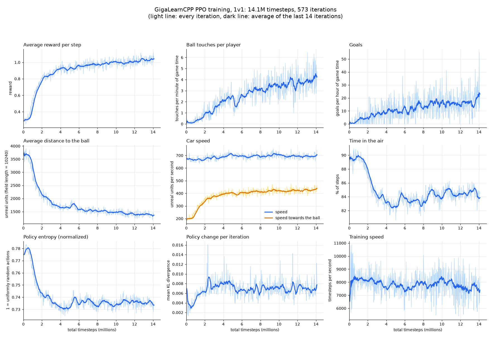

# PPO training run with GigaLearnCPP

A 1v1 Rocket League agent was trained with PPO using this repository, on the CPU of a small sandbox machine.

**Result:** after 14.1 million timesteps (30 minutes of training) the agent has clearly learned to go for the ball and hit it.
It is still a beginner: it mostly hops and flips towards the ball instead of driving, and usually loses the ball after a touch or two.
The example's own comment estimates about 100 million steps for a bot that scores on purpose, and this run is 14% of that.

| Measured over 720 minutes of game time, kickoff starts | Trained agent | Random actions |
|---|---|---|
| Ball touches per minute | **6.4** | 0.3 |
| First to touch the ball after kickoff (2,475 kickoffs) | **1,735** | 58 |
| Average distance to the ball | **1,045 uu** | 3,823 uu |
| Goals | **163** | 80 |

The trained checkpoint is in `checkpoints/14102144/`. Training continues from it when you run `./train_cpu.sh` again.

After this run I made the training code 2.1 times as fast on this machine. That work is described in `SPEED_REPORT.md`.
A second, bigger bot that plays 1v1, 2v2 and 3v3 is described in `ARCHITECTURE.md`. This report is about the 1v1
example bot, which is now selected with `--model example` (the default for its checkpoints).



## The run

| | |
|---|---|
| Machine | 1 CPU core (2 threads, Xeon 2.6 GHz), 1.9 GB RAM, no GPU |
| Software | Debian 13, GCC 14.2, libtorch 2.5.1 (CPU build), Python 3.13, bundled RocketSim 2.1.1 |
| Game | 1v1 soccar, 8 ticks per step (15 decisions per second), action delay 7 |
| Agent | The repo's example: `AdvancedObs` (109 inputs), `DefaultAction` (90 actions), the example's 10 rewards |
| Network | Shared 256-256, policy 256-256-256, critic 256-256-256, layer norm, ReLU, Adam. 516,187 parameters |
| PPO settings | 64 games at once, 24,000 steps per iteration, batch size 6,000, 2 epochs, learning rate 2e-4, entropy scale 0.035, gamma 0.99 |
| Episode starts | Half kickoffs, half random positions |
| Length | 14,102,144 timesteps in 573 iterations, 30.05 minutes, 7,820 steps per second (the current code reaches about 21,000) |

The exact command is in `train_cpu.sh` (run with `--max-minutes 30 --keep-checkpoints -1`).
The environment, rewards, observations, actions and network are those of the original `ExampleMain.cpp`.

Three things differ from the example's settings, all because of the small CPU:

- **Smaller batches.** The example uses one 50,000-step batch per iteration. At the time of this run the learner
  processed a whole batch at once on a CPU: with the example's settings the program peaked at 1.8 GB of memory on this
  1.9 GB machine. I used 24,000 steps per iteration in batches of 6,000, which peaked at 0.5 GB and gives 8 policy
  updates per iteration instead of 1. (The current code peaks at 0.74 GB and 0.38 GB.)
- **Random starts.** Half of the episodes start from a random position instead of a kickoff, so that the cars are near
  the ball more often early on. The example includes this state setter but doesn't use it.
  **Found later:** in these episodes the ball hung in the air without moving, out of reach in about 9 of 10 cases, so
  most of them taught the agent little. This run was made that way. The ball now starts with some speed
  (`--random-ball-speed`), see "The ball that hung in the air" in `ELO_REPORT.md`.
- **Learning rate** 2e-4 instead of 1.5e-4, and 2 epochs (the framework default) instead of 1.

In this run 80% of the time went into the PPO updates and 20% into simulating games. With the current code it is
63% and 37%.

## Evaluation

The numbers in the training curves come from training itself. To check them independently, I added an evaluation mode
(`GigaLearnBot --eval <checkpoint>`): it plays kickoff games in RocketSim between a checkpoint and an opponent, under
the same rules as training (a game ends on a goal, or after 10 seconds without a touch), and swaps sides in half of the games.

Each row is 720 minutes of game time against an opponent that picks random valid actions:

| Checkpoint | Agent touches / min | Random touches / min | First touch after kickoff (agent : random) | Agent's average distance to ball | Goals (agent : random) |
|---|---|---|---|---|---|
| 1.0M steps | 0.62 | 0.26 | 324 : 140 | 2,285 uu | 24 : 15 |
| 2.0M steps | 1.61 | 0.25 | 787 : 124 | 1,641 uu | 52 : 15 |
| 4.0M steps | 3.38 | 0.22 | 1,336 : 85 | 1,290 uu | 97 : 37 |
| 8.0M steps | 5.04 | 0.26 | 1,652 : 74 | 1,147 uu | 118 : 57 |
| **14.1M steps (final)** | **6.37** | 0.27 | **1,735 : 58** | **1,045 uu** | **163 : 80** |
| Final, always taking its most likely action | 9.07 | 0.29 | 1,762 : 29 | 861 uu | 212 : 61 |

Final checkpoint against its own 1.0M-step checkpoint, 720 minutes: 6.64 against 0.54 touches per minute, first touch
1,661 : 129, goals 155 : 91.

**How much these numbers vary.** Five more runs of 120 minutes each of the final checkpoint against random actions
(at that time every run had different kickoffs and random actions): 6.1 to 6.7 touches per minute and the first touch
in 67% to 72% of kickoffs every time, but goals between 22 : 7 and 33 : 5. Touches and first touches are stable. Goal counts are not, and should only be read
as "clearly more than the opponent".

The goals of the random side rise as the agent improves (15 → 80). Random actions touch the ball only about 190 times
in 720 minutes, so most of these are presumably balls the agent put into its own goal. Own goals are not counted
separately.

The raw results are in `results/eval/long_720min/` and `results/eval/repeats/`. `results/eval/` also has the first,
shorter evaluations (120 minutes each). The checkpoints of the earlier rows were in `results/policy_snapshots/`.
(Removed later: the workspace is limited to 128 MB, see "The workspace" in `ELO_REPORT.md`.)

## What the agent can and can't do

- It goes for the ball: it gets the first touch in 70% of kickoffs (1,735 of 2,475). Random actions get 2%.
- It does not control the ball. 2,216 of the 2,475 kickoffs ended without a goal, after 10 seconds with no touch.
- It is in the air 84% of the time (random actions: 89%) and averages 730 uu/s, where a car's top speed is 2,300 uu/s.
  It moves by hopping and flipping, and has not learned to drive and boost.
- It was only tested against random actions and its own earlier checkpoint, not against any other bot or a human.
- This is one run with one random seed, so I can't say how much the result varies between runs.

The policy entropy has been flat at about 0.735 since 4 million steps, where 0.78 is choosing uniformly at random.
The agent is still choosing almost randomly among its allowed actions.

## Follow-up test: a lower entropy scale

The example uses an entropy scale of 0.035, the framework default is 0.018. To see whether the high value holds the
agent back, I continued from the final checkpoint twice, for 6 minutes each (to 16.8 million steps): once with
`--entropy-scale 0.01`, and once unchanged as a control.

| Last 40 iterations of training | Entropy scale 0.01 | 0.035 (control) |
|---|---|---|
| Reward per step | 1.111 | 1.050 |
| Policy entropy | 0.698 | 0.736 |
| Average distance to the ball | 1,306 uu | 1,378 uu |
| Time in the air | 81.7% | 84.9% |

Playing against each other for 1,200 minutes of game time, the 0.01 version had 6.02 against 4.24 touches per
minute, the first touch in 2,098 against 1,128 kickoffs, and 296 : 200 goals.
Against the 14.1M checkpoint (600 minutes each) the picture is less clear: the 0.01 version had the first touch in
916 against 610 kickoffs, the control in 764 against 786.

This is one short run per setting with one seed, so it is a hint and not a result. `train_cpu.sh` still uses 0.035.
To try it: `./train_cpu.sh --entropy-scale 0.01`. The data is in `results/entropy_test/` (metrics and evaluations.
The two final checkpoints were removed later for the workspace's size limit).

## Continuing

```bash
./setup_linux.sh                        # once per machine: downloads libtorch and the arena meshes, builds (3 minutes here)
./train_cpu.sh --max-minutes 60         # continue training from the newest checkpoint for an hour
python3 tools/show_progress.py          # progress table of the running or finished training
python3 tools/plot_metrics.py metrics results/training_curves.png
./build/GigaLearnBot --eval checkpoints # newest checkpoint against random actions
./build/GigaLearnBot --help             # all options
python3 tools/benchmark.py              # steps per second and where the time goes
```

Compiling needs about 1.5 GB of memory per compiler process. If less is free, `setup_linux.sh` adds a temporary swap
file for the build (this needs sudo) and removes it afterwards.

In this workspace `./setup_linux.sh` has to be run again first: the build folder and libtorch are not kept between sessions.

Stop training with Ctrl+C or `kill`: it finishes the current iteration, saves a checkpoint and exits.
Metrics are appended to `metrics/<run id>.jsonl`. Set `GGL_WANDB=1` to also send them to Weights & Biases as the
original did.

**On a machine with an NVIDIA GPU** (not tested here): run `setup_linux.sh` with `LIBTORCH_URL` set to a CUDA build of
libtorch (see the comment at the top of the script), then start `./build/GigaLearnBot` without options. Its defaults are
the original example's GPU settings, and it continues from the same checkpoint.

**Watching the agent:** `./build/GigaLearnBot --render` sends the games of the newest checkpoint to
[RocketSimVis](https://github.com/ZealanL/RocketSimVis) on UDP port 9273. I checked that the game states are sent
(97 game states in a 7-second test), but had no display to run the visualizer itself.

**Playing it in Rocket League:** `./build/GigaLearnBot --rlbot checkpoints` starts the repo's RLBot client with the
newest checkpoint (see `rlbot/README.md`). This needs the game and the RLBot framework and is untested.

## Changes made to the repository

The repository has no installation guide, was last built on Windows, and did not compile on Linux.
All changes to the repository's source files, including the speed work, are in `changes_to_upstream.patch`.

**Needed to compile on Linux (GCC 14)**

| File | Change |
|---|---|
| `CMakeLists.txt` | Static libraries are built as position-independent code (the shared library failed to link). Defaults to a release build |
| `EnvSet.h`, `ExampleMain.cpp` | Include paths had the wrong letter case (`OBSBuilders/OBSBuilder.h`) |
| `CommonValues.h` | `#include "../Framework.h"` pointed outside the folder |
| `Models.h` | Removed an invalid `typename` |
| `Timer.h` | Mixed `steady_clock` and `high_resolution_clock`, which are different types on Linux |

**Bugs fixed** (these also exist in the Windows version)

| File | Bug |
|---|---|
| `EnvSet.cpp` | Games are created on several threads and were stored in the order they finished, while the event callbacks used the original index. Shots, goals, saves, bumps and demos were therefore credited to players in a different game. In a test on this machine 216 of 320 games were affected, and 0 after the fix. Of the example's rewards this affects the bump and demo rewards |
| `GameState.h` | `GetBoostPadTimers()` returned the timers of the mirrored pads, so `AdvancedObs` showed a boost pad that had just been taken as available |
| `GAE.cpp` | Read one element past the end of the value predictions on the last step. The value is multiplied by zero, but a NaN there would have spread to the whole iteration |
| `WelfordStat.h` | Observation statistics were saved as `means`/`vars` but loaded as `mean`/`var`, so resuming with `standardizeObs` failed |
| `Learner.cpp` | The console report asked for a metric called "KL Div Loss" that doesn't exist, so the KL divergence was never shown |
| `Reward.h` | Reward names in the metrics were mangled C++ type names on Linux (`N4RLGC9AirRewardE`), now `AirReward` |
| `src/RLBotClient.cpp` | Found later: the boost pad timers from the real game (seconds since pickup) were used as if they were the simulation's (seconds until the pad is back), so the pad inputs of taken pads were wrong in the game. Now converted. Not tested in the game |
| `GigaLearnCPP/CMakeLists.txt` | `configure_file(... COPY)`: `COPY` is not an option of this command. CMake warned and processed the Python script as a template instead of copying it. Now `COPYONLY` |

**Running without a terminal or a wandb account**

| File | Change |
|---|---|
| `KeyPressDetector`, `Learner.cpp` | Without a terminal the "press Q to quit" thread looped without pause and flooded the error output (157,000 calls and 471,000 error lines in half a second, measured). It is now only started in a terminal, and the terminal is restored on exit |
| `Learner.h/.cpp` | New `quitRequested` flag. `Start()` saves and returns instead of calling `exit(0)`, and the last report is now sent before stopping |
| `python_scripts/metric_receiver.py` | Writes metrics to a local `.jsonl` file. wandb was mandatory, now optional with `GGL_WANDB=1` |

**New**

| File | Purpose |
|---|---|
| `src/ExampleMain.cpp` | Same bot as the original example, plus command-line options, automatic CPU/GPU choice, time and timestep limits, and the `--eval`, `--render` and `--rlbot` modes |
| `setup_linux.sh` | Installs the dependencies and builds. Tested from an empty state on this machine |
| `train_cpu.sh` | The training command used for this run |
| `tools/plot_metrics.py`, `tools/show_progress.py` | Training curves and progress table from the metrics file |
| `tools/benchmark.py`, `FusedLayer.h/.cpp`, `tests/TestLearnerMath.cpp` | Part of the speed work, see `SPEED_REPORT.md` (which also lists the files changed for it) |

My changes were only built and run on Linux. I kept them compatible with Windows/MSVC as far as I could tell, but did not
build there.

The 16 arena collision meshes that RocketSim needs are not part of the repository. The setup script takes them from
the source package of `rlgym-rocket-league` on PyPI. They contain the game's arena geometry.

## Files

| Path | Content |
|---|---|
| `checkpoints/14102144/` | Final checkpoint: policy, shared layers, critic, optimizer states, run statistics |
| `results/training_curves.png` | The plot above |
| `results/training_metrics.jsonl` | All metrics of all 573 iterations |
| `results/train_log.txt` | Console output of the training run |
| `results/eval/` | Evaluation results as JSON: `long_720min/` (the tables above), `repeats/`, and the first 120-minute runs |
| `results/policy_snapshots/` | Policies after 1, 2, 4 and 8 million steps. Removed later: the workspace is limited to 128 MB |
| `results/entropy_test/` | The follow-up test: metrics and evaluations of both continuations (the final checkpoints were removed later for the size limit) |
| `results/speed/` | Benchmark records and the 4-million-step check run of the speed work |
| `SPEED_REPORT.md` | The speed work: measurements, what changed, how it was checked |
| `ARCHITECTURE.md` | The bot for 1v1, 2v2 and 3v3: inputs, network, size, first training run |
| `ELO_REPORT.md` | 1v1 training rated with GigaLearn's Elo rating (logged to Weights & Biases), experiments on the training setup |
| `changes_to_upstream.patch` | All changes to the repository's source files |
